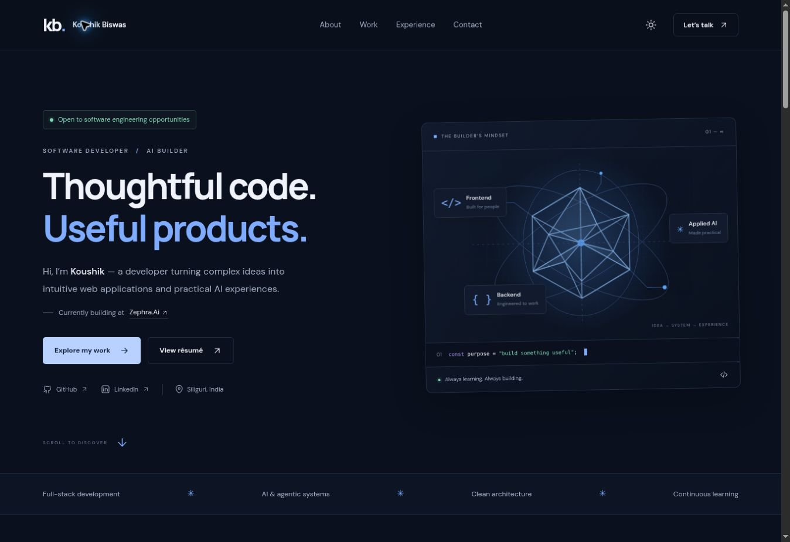

# Koushik Biswas — Portfolio

**Live website:** https://koushik-biswas-portfolio.vercel.app/



A responsive navy-and-white professional portfolio based on the supplied CV, with light and dark modes, selected projects, experience, education, a printable web résumé, and an email contact form.

## Features

- Responsive layouts for phones, tablets, and desktop.
- Dark/light theme with a saved preference and system-theme support.
- Accessible mobile navigation, keyboard focus, and reduced-motion support.
- Signal Studio, Agentic RAG, GoCart, and Quick Chat project showcases.
- Click-to-email Gmail address and click-to-call phone number.
- A validated contact form with a honeypot, timeout, duplicate-submit protection, and visible error/success feedback.
- A separate web résumé with Print / Save PDF support.
- Dependency-free static build for Vercel or GitHub Pages.

The interface illustrations are CSS/SVG studies, not screenshots of the live projects. Personal claims and links are based on the supplied CV. The chat description does not claim independently verified end-to-end encryption.

## Local development

Use Node.js 22 or newer. No dependencies need installing.

```sh
npm run dev
```

Open http://localhost:3000. Validate and build:

```sh
npm run check
npm run build
```

The build writes public files to `dist/`. Tooling and configuration are excluded.

## Deploy on Vercel

The repository is linked to the Vercel project **koushik-biswas-portfolio** in the owner's account. Production is live at https://koushik-biswas-portfolio.vercel.app/.

The included `vercel.json` sets:

| Setting | Value |
| --- | --- |
| Framework | Other |
| Build command | npm run build |
| Output directory | dist |
| Environment variables | None |

The project uses the owner's existing Hobby account and deploys from `main` through the GitHub connection. No custom domain, paid backend, or environment variables are required.

## Deploy on GitHub Pages

1. Open **Settings → Pages** in this repository.
2. Select **GitHub Actions** as the publishing source.
3. Open **Actions → Deploy portfolio to GitHub Pages → Run workflow**.

The optional Pages workflow builds `dist/` and deploys it. The separate check workflow validates source on pushes and pull requests. Relative asset paths support the `/Portfolio/` subdirectory.

The GitHub connector used to upload this code cannot enable Pages through its exposed tools; the one-time Pages setting must be enabled in GitHub before that deployment workflow can succeed.

## Activate email delivery once

Recipient: **koushikbiswas2423@gmail.com**.

The contact form uses [FormSubmit](https://formsubmit.co/). Submit one message from the live website, open the confirmation email in Gmail, and click **Activate Form**. Check Spam if it is missing. FormSubmit retains pending submissions for 30 days according to its [help page](https://formsubmit.co/help).

The visitor's email is included as Reply-To. The form keeps the visitor's text when the network fails. Without JavaScript, a normal POST opens FormSubmit's submission and verification flow. Delivery depends on the provider's availability and activation. No inbox delivery has been independently confirmed.

## Content editing

- `index.html`: biography, projects, experience, skills, contact details.
- `styles.css`: themes, responsive layouts, and interface illustrations.
- `app.js`: theme controls, navigation, and contact form.
- `resume.html`: CV-derived printable web résumé.
- `resume.js`: print action.
- `assets/favicon.svg`: monogram.

The original uploaded CV PDF is not included in this repository. The web résumé contains the CV information and can be printed or saved as PDF by the visitor.

## Verification record

GitHub Actions passed the source checks and static build. Phone and tablet layouts were checked for overflow, and the mobile menu and both themes were checked in the browser. Vercel reported the production deployment READY, and the public production URL returned HTTP 200 and displayed the portfolio without a sign-in prompt. Real email delivery has not been verified; the owner must activate FormSubmit after the first submission.
